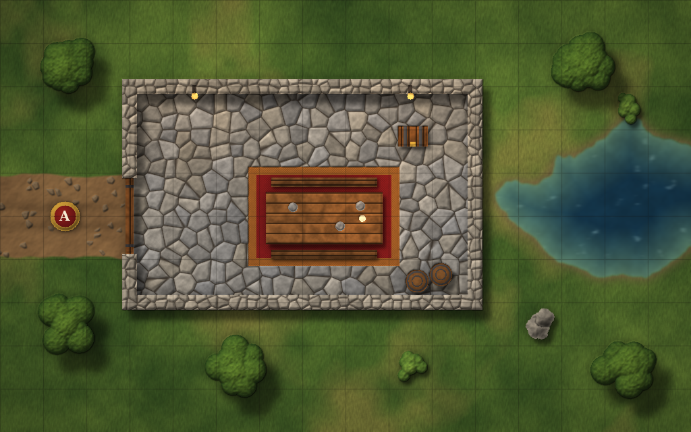
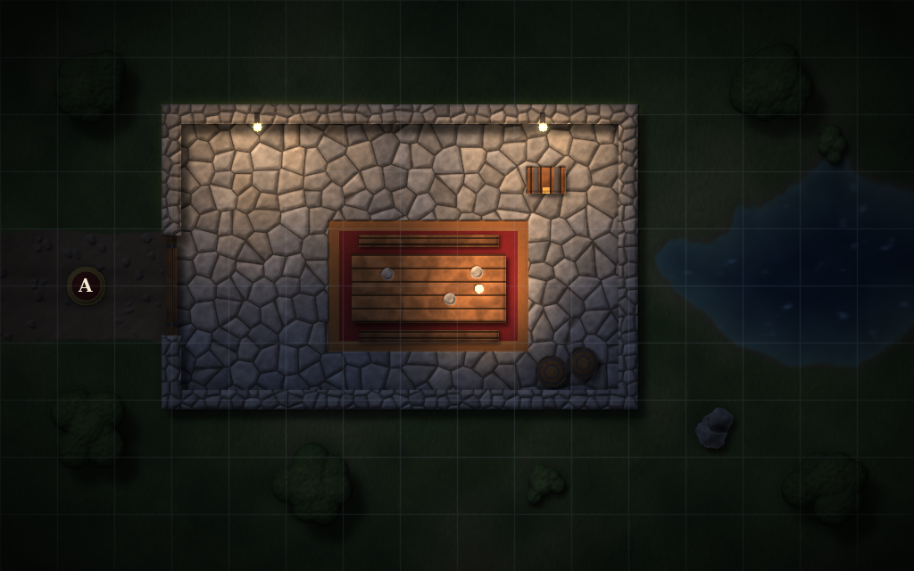
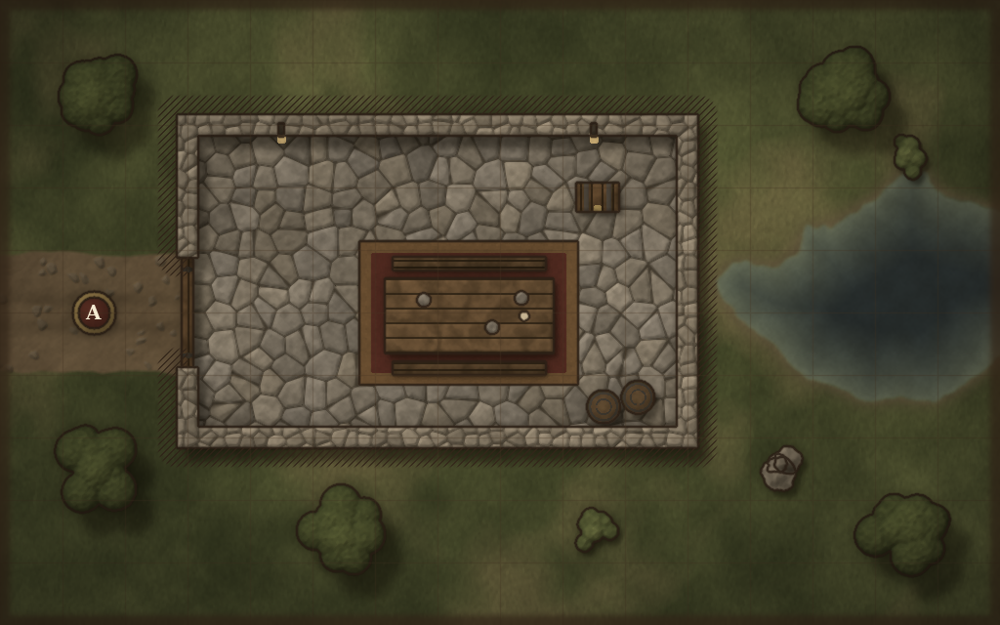
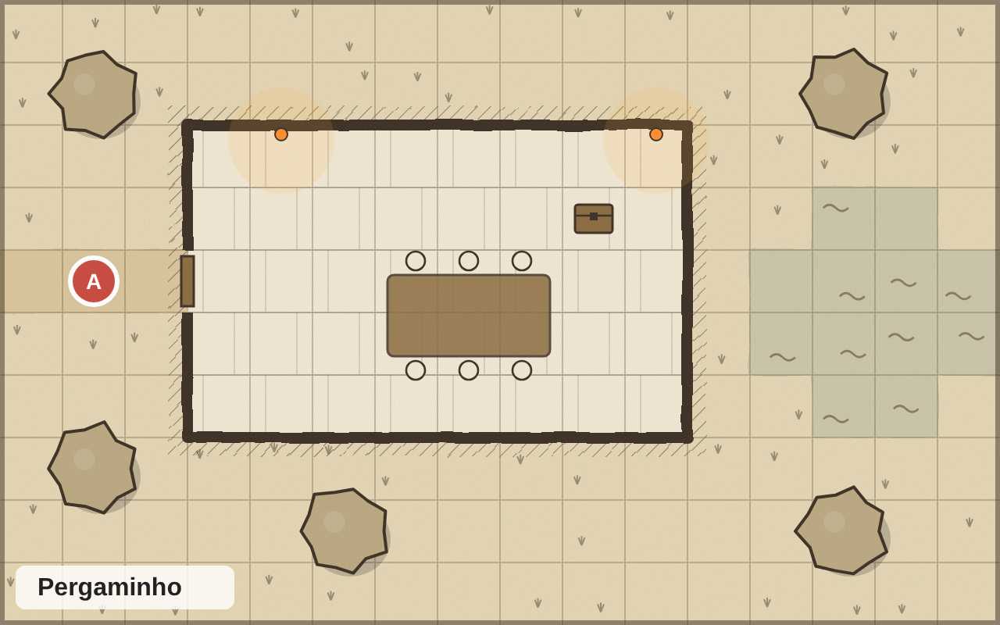

# Propostas de estilo visual

## Rodada 2: estilos realistas (atual)

As três imagens mostram **o mesmo mapa** (salão de pedra com mesa, bancos, tapete, baú, barris, tochas e porta, mais estrada, lago, rochas e árvores). Tudo é gerado por código em `tools/estilos_realistas.py`: texturas procedurais (ruído fractal, Voronoi para pedras), mapas de relevo com luz direcional, sombras projetadas, oclusão nos cantos e luz das tochas. Por isso o resultado é original, reprodutível e livre de licenças de terceiros, e as mesmas texturas viram o pacote de assets do editor.

| | Estilo | Ideia | Bom para |
|---|---|---|---|
|  | **1. Realista diurno** | Luz do sol, sombras projetadas, materiais com relevo (pedra, madeira, água com profundidade) | Uso geral, mostrar na TV ou em mesa virtual |
|  | **2. Masmorra noturna** | O mesmo mapa à noite: luar frio do lado de fora e luz quente das tochas e da vela dentro | Masmorras, horror, clima tenso. É também a base visual da iluminação dinâmica da fase 5 |
|  | **3. Cartografia ilustrada** | Texturas realistas com contorno a tinta, tons de sépia, papel envelhecido e hachura nas paredes | Impressão, clima de mapa antigo de aventura |

Regenerar: `pip install -r tools/requirements.txt && python3 tools/estilos_realistas.py`

## Rodada 1: estilos simples (substituída)

As três imagens mostram **o mesmo mapa de exemplo** (sala com mesa, baú, tochas, porta, estrada, lago e árvores) em estilos diferentes. Elas são geradas por `tools/gerar-estilos.py`, então ajustes de cor e traço são rápidos.

| | Estilo | Ideia | Bom para |
|---|---|---|---|
|  | **1. Pergaminho** | Tinta escura sobre papel envelhecido, hachuras nas paredes, cores sóbrias | Imprimir, clima clássico de aventura |
|  | **2. Aquarela** | Cores suaves e vivas, bordas levemente irregulares | Mostrar na TV, mesas iniciantes, leitura rápida do terreno |
|  | **3. Noturno** | Fundo azul escuro com linhas que brilham | Salas escuras, sci‑fi/horror, economizar tinta não importa |

A escolha define a paleta, o traço das paredes e o estilo do pacote de assets inicial. A interface do editor continua escura nos três casos.

## Nome

Escolhido: **Atlas Board** (19/11/2026). Ainda falta a pesquisa de marca registrada antes do beta público.
