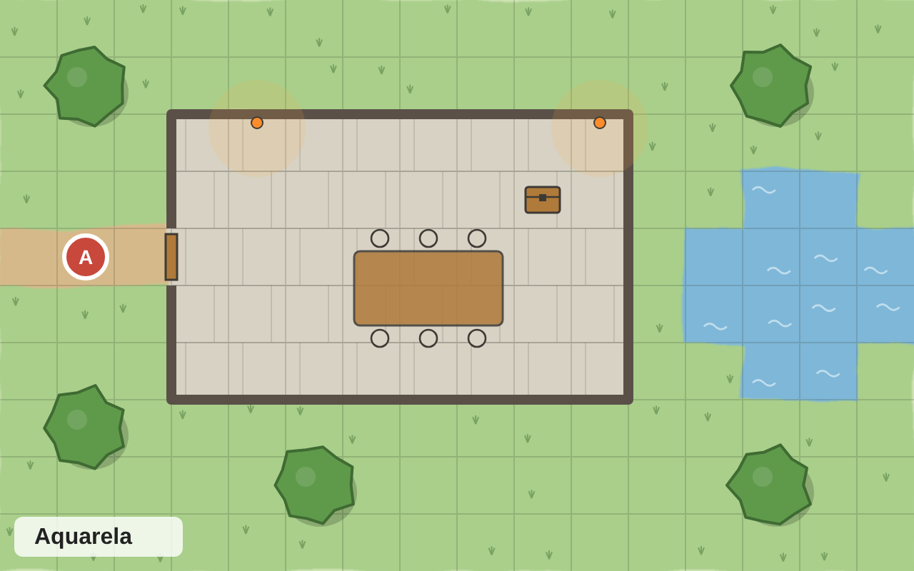
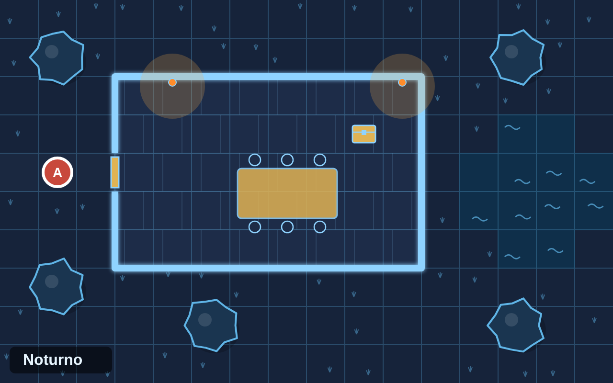

# Propostas de estilo visual (fase 0)

As três imagens mostram **o mesmo mapa de exemplo** (sala com mesa, baú, tochas, porta, estrada, lago e árvores) em estilos diferentes. Elas são geradas por `tools/gerar-estilos.py`, então ajustes de cor e traço são rápidos.

| | Estilo | Ideia | Bom para |
|---|---|---|---|
|  | **1. Pergaminho** | Tinta escura sobre papel envelhecido, hachuras nas paredes, cores sóbrias | Imprimir, clima clássico de aventura |
|  | **2. Aquarela** | Cores suaves e vivas, bordas levemente irregulares | Mostrar na TV, mesas iniciantes, leitura rápida do terreno |
|  | **3. Noturno** | Fundo azul escuro com linhas que brilham | Salas escuras, sci‑fi/horror, economizar tinta não importa |

A escolha define a paleta, o traço das paredes e o estilo do pacote de assets inicial. A interface do editor continua escura nos três casos.

## Propostas de nome

1. **Forja de Mapas**
2. **Atlas da Mesa**
3. **Cartógrafo RPG**

Ainda não foi feita pesquisa de marca registrada; isso entra antes do beta público.
